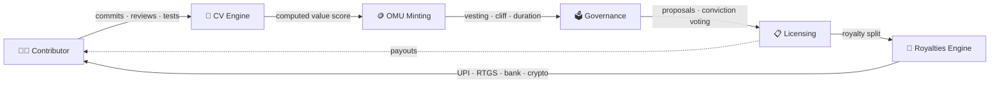

<div align="center">

# ⚖️ QUILD

### Open-Source Patent Commons Platform

**Full-lifecycle IP management for research projects** — from inception and patent filing to validation, licensing, micro-ownership, royalties, and community governance.

`Micro-Ownership` · `CV Engine` · `Royalties & Governance`

<br/>

<a href="https://github.com/Aryan0047-ak/QUILD/stargazers">

</a>
<a href="https://github.com/Aryan0047-ak/QUILD/network">

</a>
<a href="https://github.com/Aryan0047-ak/QUILD/issues">

</a>
<a href="https://github.com/Aryan0047-ak/QUILD/pulls">

</a>


</div>

<br/>

## 📚 Table of Contents

- [✨ What is QUILD?](#-what-is-quild)
- [🧩 Features](#-features)
- [🖼️ Architecture](#️-architecture)
- [🛠️ Tech Stack](#️-tech-stack)
- [🚀 Getting Started](#-getting-started)
- [📁 Project Structure](#-project-structure)
- [🗺️ Roadmap](#️-roadmap)
- [🤝 Contributing](#-contributing)
- [📜 License](#-license)

---

## ✨ What is QUILD?

QUILD is a modern, **analytics-first control plane for open-source patent commons (OSPC)**. It gives research groups, startups, and patent pools a single workspace to run their IP portfolio like a business — tracking projects, patents, validations, revenue, contributors, and treasury in one place.

It moves beyond classic IP management by modelling **micro-ownership** at the contributor level:

| Primitive | What it does |
|-----------|--------------|
| 🪙 **OMU** | *On-chain Micro-ownership Units* — a contributor's fractional stake in a project, minted against contributions and governed by vesting schedules (cliff + duration). |
| 🧠 **CV Engine** | *Computed Value* — a multi-dimensional score across 16 dimensions: commit weight, review depth, test coverage, refactoring, ADRs, issue triage, benchmark improvements & more. |
| 💸 **Royalties Engine** | Automates gross settlement, a micropayment accumulator with per-project wallets, and tax compliance (TDS) with payouts via **UPI, bank transfer, RTGS, or crypto**. |

---

## 🧩 Features

<details open>
<summary><b>🟦 Core</b></summary>

| Module | Highlights |
|--------|------------|
| 📊 **Dashboard** | Live KPIs (projects, active IPs, revenue, investors), portfolio trends, ownership distribution, activity feed |
| 📁 **Projects** | Full CRUD across AI, Biotech, Hardware, Blockchain & Quantum; TRL tracking, treasuries, vesting config, `omu_weighted` / `cv_weighted` governance models |
| 🛡️ **Validation** | Scorecard-driven review workflow for technology, patents, trademarks & copyrights — `pending → in_review → verified / rejected` |
| 🗂️ **IP / Patents** | Portfolio management across provisional, full, PCT & continuation filings; jurisdictions, inventors, valuation, lifecycle status (`draft → filed → examined → granted`) |
| 🏪 **Marketplace** | Buy & sell technology, patents, trademarks, and data; price tracking, views/likes, transaction history |
| 💰 **Revenue** | Full income/expense ledger across investments, licensing, sales, grants, and royalties |

</details>

<details>
<summary><b>🟨 OSPC (NEW)</b></summary>

| Module | Highlights |
|--------|------------|
| 👥 **Contributors** | CV Engine scoring on 16 contribution dimensions, OMU holdings (locked vs transferable), reputation scores & badges |
| 🗳️ **Governance** | Decentralised decision-making with **liquid democracy & conviction voting**; proposals for parameter changes, licenses, budgets, and emergencies |
| 🎁 **Royalties** | Real-time gross settlement, micropayment accumulator, per-contributor & per-project payouts, tax-compliant rails (UPI, RTGS, bank transfer, crypto) |

</details>

---

## 🖼️ Architecture

How value flows through the platform:



---

## 🛠️ Tech Stack

<div align="center">
  
  
  
</div>

| Layer       | Tech                                                        |
|-------------|-------------------------------------------------------------|
| Framework   | [Next.js](https://nextjs.org) 16 · App Router               |
| UI Library  | [React](https://react.dev) 19                               |
| Styling     | [Tailwind CSS](https://tailwindcss.com) v4                  |
| Charts      | [Recharts](https://recharts.org)                            |
| Animation   | [Framer Motion](https://motion.dev)                         |
| Icons       | [lucide-react](https://lucide.dev)                          |
| Language    | [TypeScript](https://www.typescriptlang.org)                |
| Tooling     | ESLint · PostCSS                                            |

---

## 🚀 Getting Started

### Prerequisites

- [Node.js](https://nodejs.org) ^20
- npm (ships with Node.js)

### Installation

```bash
# 1. Clone the repository
git clone https://github.com/Aryan0047-ak/QUILD.git
cd QUILD

# 2. Install dependencies
npm install

# 3. Run the development server
npm run dev
```

Open [http://localhost:3000](http://localhost:3000) — the app redirects to `/dashboard`.

### Available Scripts

<details open>
<summary><b>Click to expand</b></summary>

```bash
npm run dev       # start the development server
npm run build     # create a production build
npm run start     # serve the production build
npm run lint      # run ESLint
```

</details>

---

## 📁 Project Structure

```
QUILD/
├── src/
│   ├── app/                    # App Router pages
│   │   ├── dashboard/          #   KPIs, charts, ownership, activity
│   │   ├── projects/           #   Project CRUD & portfolio
│   │   ├── validation/         #   Validation workflow
│   │   ├── ip/                 #   Patent portfolio
│   │   ├── marketplace/        #   IP/technology listings
│   │   ├── revenue/            #   Income & expense ledger
│   │   ├── contributors/       #   CV Engine, OMU & reputation
│   │   ├── governance/         #   Proposals & conviction voting
│   │   └── royalties/          #   Royalties & micropayments
│   ├── components/             # Sidebar, Header, Modal
│   └── lib/                    # Types, mock data, OSPC store
├── package.json
└── next.config.ts
```

---

## 🗺️ Roadmap

- [x] Project & IP portfolio management
- [x] Validation & scoring workflow
- [x] Marketplace & revenue tracking
- [x] CV Engine scoring
- [x] OMU issuance with vesting schedules
- [x] Decentralised governance (conviction voting)
- [x] Royalties engine with tax compliance
- [ ] Backend persistence & auth
- [ ] On-chain OMU & payout distribution
- [ ] Analytics & reporting suite

---

## 🤝 Contributing

Contributions are welcome! 🎉

1. 🍴 Fork the repo
2. 🌿 Create a feature branch (`git checkout -b feature/amazing`)
3. 💾 Commit your changes (`git commit -m 'Add amazing feature'`)
4. 🚀 Push to the branch (`git push origin feature/amazing`)
5. 🔀 Open a pull request

Make sure `npm run lint` and `npm run build` pass before submitting.

---

## 📜 License

Distributed under the **MIT License**. See [`LICENSE`](https://opensource.org/license/mit) for more information.

<br/>

<div align="center">

**Made with 🖤 by the QUILD team**

⭐ Found this useful? Give the repository a star!

</div>